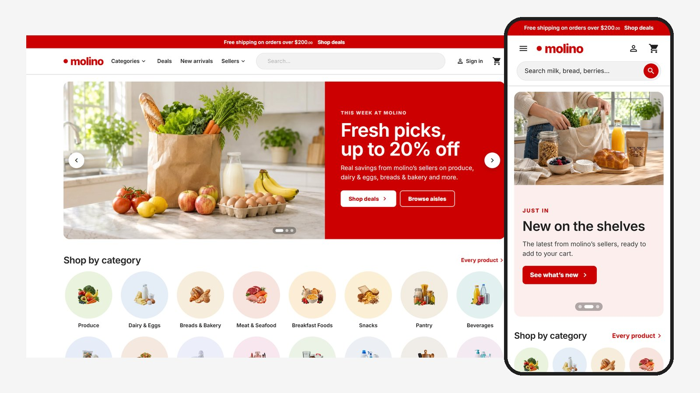

<p align="center">
  
</p>

<h1 align="center">Tario Market</h1>

<p align="center">
  <b>A bright red, big-box style storefront for a Selldone grocery marketplace.</b><br>
  A custom Selldone Layout built on the official <a href="https://github.com/selldone/storefront">selldone/storefront</a>.
</p>

<p align="center">
  <a href="https://tario.selldone.shop"></a>
  <a href="https://github.com/selldone-custom-layouts/official-tario/wiki"></a>
  <a href="https://github.com/selldone-custom-layouts/official-tario/wiki/Install-with-AI"></a>
  
  
</p>

<p align="center">
  <a href="https://tario.selldone.shop"><b>Open the live shop</b></a> ·
  <a href="https://github.com/selldone-custom-layouts/official-tario/wiki/Install-with-AI">Set it up with AI</a> ·
  <a href="https://github.com/selldone-custom-layouts/official-tario/wiki/Manual-Setup">Manual setup</a> ·
  <a href="https://github.com/selldone-custom-layouts/official-tario/wiki/Shop-Requirements">What your shop needs</a> ·
  <a href="https://github.com/selldone-custom-layouts">All Selldone custom layouts</a>
</p>

---

## What it is

**Tario Market** dresses a grocery marketplace like a big-box store:
- red for every action and every saving;
- near-black headings in a heavy sans;
- a big-box home: a hero that turns, round categories, rows of cards with a red **Add to cart**, promo tiles and lifestyle photos;
- white cards on light-grey wells;
- a checkout laid out as numbered steps.

It runs on **[tario.selldone.shop](https://tario.selldone.shop)**, a second address of the same Selldone shop, molino. The shop's main address keeps its own Layout, [Molino Market Hall](https://github.com/selldone-custom-layouts/official-molino). Selldone lets each domain of a shop carry its own Layout.

Selldone's own basket, checkout, payments, vendor offers and orders keep working underneath. Nothing about the shop is hard-coded: the name, logo, aisles, sellers and prices all come from the shop that runs it.

## Highlights

- **Header:** a red promo strip with the shop's own free-shipping rule, then the wordmark with its round red dot, **Categories**, Deals, New arrivals and **Sellers** menus, a wide search pill with a round red button, Sign in and the cart with its count.
- **Home:**
  - a split hero that turns: the week's deals ("up to N% off", read live), what is new, and the fresh aisle;
  - "Shop by category" as rows of round pictures;
  - **Top deals** and **New arrivals** rows;
  - "Deals for every aisle": promo tiles that say what each aisle has on offer;
  - "Ways to get it": pickup, delivery and shipping with their free rules, from the shop's settings;
  - "Fresh finds": three tall editorial tiles;
  - "Trending in" every aisle, and the sellers.

  Eleven lifestyle photos ship in [`assets/tario/`](assets/tario/); a missing one is replaced by the aisle's own packshots. Empty sections fold away.
- **Cards:** the price first and large (red on offer, "reg $x" and "Sale" beside it), the name, "★★★★☆ 4.2 (19)" once rated, who sells it, and a square red **Add to cart** that turns into "− 1 in cart +" in place; products with sizes say "Choose options".
- **Product page:**
  - a gallery, details and a sticky buy box with every seller's offer;
  - the struck price and percentage follow the chosen seller;
  - reviews in a summary column beside the comments.
- **Checkout as steps:**
  - **1 Review your items**, by seller, with steppers;
  - **2 Delivery & contact**: delivery method, a map-first address sheet that suggests while typing and works in two steps on phones, and the email;
  - **3 Order summary**: every line of Selldone's bill and a red button that leads to whatever is missing before it pays.
- **Orders and account:** the receipt, delivery card, the trip and chat, and the buyer account.
- **Everywhere:** no "Added to cart" pop-ups and no phone bottom bar.

## Use it on your shop

| You want to… | Read |
| --- | --- |
| Let an AI agent (Claude Code, Codex…) set it up for your shop | [Install with AI](https://github.com/selldone-custom-layouts/official-tario/wiki/Install-with-AI) |
| Do it yourself, step by step | [Manual Setup](https://github.com/selldone-custom-layouts/official-tario/wiki/Manual-Setup) |
| Know what data your shop needs for the design to look right | [Shop Requirements](https://github.com/selldone-custom-layouts/official-tario/wiki/Shop-Requirements) |
| Build, upload and verify a release | [Build and Upload](https://github.com/selldone-custom-layouts/official-tario/wiki/Build-and-Upload) |
| Put the Layout live on your shop, or on one domain of it | [Go Live](https://github.com/selldone-custom-layouts/official-tario/wiki/Go-Live) |
| Change colours, fonts, sections or pages | [Customize](https://github.com/selldone-custom-layouts/official-tario/wiki/Customize) |
| Fix a blank page, a rejected upload or an old version showing | [Troubleshooting](https://github.com/selldone-custom-layouts/official-tario/wiki/Troubleshooting) |

The wiki's source is also in [`docs/wiki/`](docs/wiki/).

## Quick start (developers)

```bash
git clone --recurse-submodules https://github.com/selldone-custom-layouts/official-tario.git
cd official-tario
npm install --force
npm run serve            # dev server on http://localhost:9124
```

Releases: `bash scripts/release.sh <new-version> desk`. See [Build and Upload](https://github.com/selldone-custom-layouts/official-tario/wiki/Build-and-Upload).

## Where things are

| Area | Files |
| --- | --- |
| The home page (design A) and its photos | [`components/tario/`](components/tario/), [`style/tario-home.scss`](style/tario-home.scss), [`assets/tario/`](assets/tario/) |
| Tario's dress: header, footer, wells, checkout steps | [`style/tario-skin.scss`](style/tario-skin.scss), [`style/tario-home.scss`](style/tario-home.scss) |
| Tokens: red, near-black, Inter, corners | [`style/kalio-tokens.scss`](style/kalio-tokens.scss) |
| What Tario changed from Molino, and why | [`TARIO.md`](TARIO.md) |
| The components and every behaviour (shared with Molino) | [`components/kalio/`](components/kalio/), [`KALIO.md`](KALIO.md) |
| Release tooling | [`scripts/`](scripts/) |
| Selldone storefront's original README | [`README.selldone.md`](README.selldone.md) |

The code shares its components with [Molino Market Hall](https://github.com/selldone-custom-layouts/official-molino): the class names start with `k-` and the files with `kalio-`. Tario's own pieces start with `t-` / `tario-`.

## Credits and license

Built on the official [Selldone Storefront](https://github.com/selldone/storefront) (MIT License, © Selldone); see [`LICENSE.md`](LICENSE.md). Part of **[Selldone Custom Layouts](https://github.com/selldone-custom-layouts)**.
